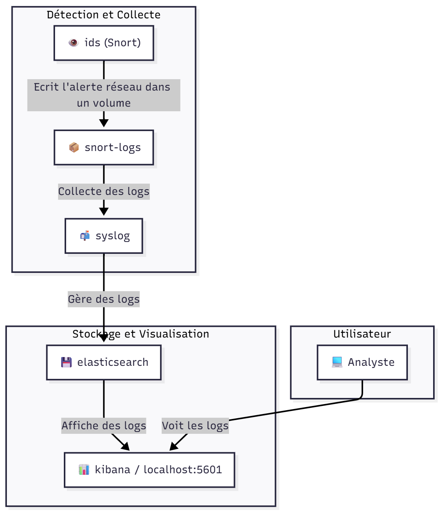

# Log-Based Intrusion Detection Lab: Snort + syslog-ng + ELK

> A containerized mini-SIEM: Snort watches the network, syslog-ng ships its alerts to Elasticsearch, Kibana shows them, and attack scripts let you see detections live.


Security project at UQAC by **Antony Huynh** and **Antoine Riom**.
[Version française](README.fr.md)

<p align="center">
  
</p>

## Architecture

| Container | Role |
|---|---|
| **Snort** | Network IDS, listens on `eth0` and writes alerts to `/var/log/snort/alert.fast` |
| **syslog-ng** | Reads Snort alerts and forwards them to Elasticsearch |
| **Elasticsearch** | Stores and indexes the alerts |
| **Kibana** | Web UI to search and visualize alerts |
| **Target server** | Small web + SSH server used as the victim |

## Quick start

Requires Docker Engine and Docker Compose (Linux, macOS, or Windows with WSL 2).

```bash
docker-compose up --build     # start the stack
docker-compose down           # stop it
```

Then open Kibana at **http://localhost:5601**, and create a data view:
*Stack Management → Data Views → Create data view*, with name and index pattern `snort-*` and timestamp field `@timestamp`. Step-by-step screenshots are in the [French guide](README.fr.md#️-configuration-de-kibana).

## Attack scenarios

Once all services are up (`docker ps`), run a scenario from the project root:

```bash
./scripts-attacks/scenario2.sh
```

| Scenario | Attack | What it shows |
|---|---|---|
| 2 | Port scan (`nmap`, top 100 TCP ports) | Detection of reconnaissance from network behavior, without any payload |
| 3 | SSH brute force (10 failed logins) | Collecting and analyzing host authentication logs |
| 4 | ICMP ping flood (`hping3`) | Detection of volumetric denial-of-service traffic |
| 5 | SQL injection over HTTP | Payload-based detection with custom Snort rules |

Why each scenario was chosen: [docs/attacks/attacks.md](docs/attacks/attacks.md).
Custom detection rules: [docker/ids/config/local.rules](docker/ids/config/local.rules).

## Limits and next steps

- **No proactive alerting:** someone has to watch Kibana. Next step: Kibana alerting or ElastAlert to notify by email or Slack.
- **No prioritization:** every alert has the same weight. Next step: enrich logs (severity, IP geolocation) and correlate events, for example with Logstash.
- **Dashboards:** dedicated Kibana dashboards for critical threats.
- **Automated response:** a SOAR layer could block an attacker's IP at the firewall as soon as an alert fires.

## Project layout

```
docker/elasticsearch/   Elasticsearch image and config
docker/ids/             Snort image, config template and local rules
docker/kibana/          Kibana image and config
docker/server/          target server with syslog-ng client
docker/ssh_brutforce/   attacker container for the SSH scenario
docker/syslog/          central syslog-ng forwarder
scripts-attacks/        attack scenarios
docs/                   diagram, Kibana screenshots, scenario rationale
docker-compose.yml
```
